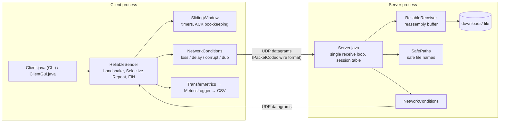

# Anchor — Reliable Transport Protocol over UDP

**Anchor: Design and Implementation of a Custom Reliable Transport Protocol over UDP in Java**

UDP gives no delivery, ordering or duplicate guarantees. **Anchor** provides an application-layer
reliability protocol on top of `DatagramSocket` to reliably transfer files between a **client** and a
**server**. It implements Selective Repeat ARQ, sequence numbers, packet acknowledgements, timeout-driven
retransmissions, a sliding window flow control mechanism, and SHA-256 integrity verification.

All application data travels purely in UDP datagrams. TCP is not used anywhere.

| Document | Contents |
|---|---|
| this README | build/run, architecture, metrics, tests, experiment, limitations, file map |
| [docs/PROTOCOL.md](docs/PROTOCOL.md) | packet format, state diagrams, the Selective Repeat algorithm in detail |
| [docs/WIRESHARK.md](docs/WIRESHARK.md) | capturing and reading the protocol in Wireshark |
| [docs/DEMO_AND_VIVA.md](docs/DEMO_AND_VIVA.md) | 5-minute demo script and viva questions with answers |
| [tests/TEST_RESULTS_TEMPLATE.md](tests/TEST_RESULTS_TEMPLATE.md) | blank results sheet to fill in with *your* measurements |

---

## 1. Prerequisites

* **JDK 17 or newer** (`javac -version`). Developed and tested on OpenJDK 21 / Linux.
* Optional: **Maven 3.8+** (only for `mvn test`), **Wireshark** (packet inspection), a second computer on the same LAN (for the real-network demo).
* No third-party libraries at runtime. JUnit 5 is needed only to run the tests.

## 2. Build

### Linux / macOS
```sh
./scripts/build.sh
# equivalent to:
mkdir -p out/main && javac -d out/main $(find src/main/java -name '*.java')
```

### Windows (Command Prompt)
```bat
scripts\build.bat
:: equivalent to:
mkdir out\main
dir /s /b src\main\java\*.java > out\sources.txt
javac -d out\main @out\sources.txt
```

(With Maven: `mvn compile` puts classes in `target/classes`; use that directory instead of `out/main` in the commands below.)

## 3. Run the server

```sh
# Linux / macOS
java -cp out/main reliableudp.Server 5000
# Windows
java -cp out\main reliableudp.Server 5000
```

Received files are stored in `./downloads` (change with `--dir`). Server options:

| Option | Meaning | Default |
|---|---|---|
| `<port>` | UDP port to listen on (`0` = pick a free one) | required |
| `--dir <path>` | downloads directory | `downloads` |
| `--window <n>` | receive window in packets (advertised to the client) | 64 |
| `--linger <ms>` | keep a finished session so a repeated FIN can be answered | 5000 |
| `--idle <ms>` | abort sessions silent for this long, delete partial files | 30000 |
| `--max-size <bytes>` | largest accepted file | 1 GiB |
| `--loss/--delay/--jitter/--corrupt/--dup/--seed` | simulated impairment of packets the **server sends** | off |
| `--log-file <path>` | also write the log to a file | – |
| `--verbose` | log every packet | off |

## 4. Run the client

```sh
# Linux / macOS
java -cp out/main reliableudp.Client localhost 5000 path/to/file.txt
# Windows
java -cp out\main reliableudp.Client localhost 5000 C:\path\to\file.txt
```

If the file argument is omitted the client asks for it (`java -cp out/main reliableudp.Client localhost 5000`).
`--gui` starts the optional Swing interface (`java -cp out/main reliableudp.Client localhost 5000 --gui`).

| Option | Meaning | Default |
|---|---|---|
| `--chunk <bytes>` | file bytes per DATA packet (≤ 1450 avoids IP fragmentation on Ethernet) | 1024 |
| `--window <n>` | sender window (packets that may be in flight) | 16 |
| `--timeout <ms>` | retransmission timeout (fixed) | 200 |
| `--retries <n>` | retransmissions per packet before giving up | 10 |
| `--loss <0..1>` | **simulated** drop probability of packets the client sends | 0 |
| `--delay <ms>` / `--jitter <ms>` | simulated one-way delay / extra random delay `0..jitter` | 0 / 0 |
| `--corrupt <0..1>` | probability that one random bit of a sent packet is flipped | 0 |
| `--dup <0..1>` | probability that a packet is sent twice | 0 |
| `--seed <n>` | PRNG seed for the simulator | 1 |
| `--csv <path>` / `--no-csv` | statistics output | `logs/transfers.csv` |
| `--scenario <text>` | label written into the CSV | `manual` |
| `--verbose` | show every packet sent/received | off |

Exit code: `0` = success **and** SHA-256 match, `1` = failure, `2` = usage error.

Example with 10 % simulated loss and 50 ms simulated delay in both directions:
```sh
java -cp out/main reliableudp.Server 5000 --loss 0.10 --delay 50 --seed 7 &
java -cp out/main reliableudp.Client localhost 5000 sample.txt --loss 0.10 --delay 50 --seed 3 --timeout 300 --window 32
```

### Across two computers (LAN demo)
1. Start the server on computer A (`java -cp out/main reliableudp.Server 5000`); find its LAN IP (`ip addr` / `ipconfig`).
2. Allow inbound **UDP 5000** in A's firewall (Windows: *Windows Defender Firewall → Advanced settings → Inbound rule → UDP 5000*).
3. On computer B: `java -cp out/main reliableudp.Client <SERVER_IP> 5000 sample.txt`.

## 5. Tests

```sh
./scripts/run-tests.sh          # javac + JUnit console launcher, no Maven   (Windows: scripts\run-tests.bat)
mvn test                        # with Maven
```
`run-tests` needs the JUnit console jar (`export JUNIT_CONSOLE=/path/to/junit-platform-console-standalone-*.jar`;
on Debian/Ubuntu `sudo apt install junit5` provides one at the default path used by the script).

The suite has 70 tests and finishes in roughly 10–15 s. It exercises the **real** `Server`, `Client`, `ReliableSender`
and `ReliableReceiver` over UDP on loopback with separate ports (server on an ephemeral port), and re-hashes the
destination file with SHA-256 after every successful transfer. Mapping to the 15 required scenarios is in
[tests/TEST_RESULTS_TEMPLATE.md](tests/TEST_RESULTS_TEMPLATE.md). Where the scenario needs a *specific* failure
(e.g. "the first two FIN_ACKs are lost") the simulator has a deterministic drop-rule hook instead of relying on probability.

Test layout (`src/test/java/reliableudp/`):

| Class | What it proves |
|---|---|
| `protocol/PacketCodecTest` | byte layout, round trips, every single-bit flip detected, truncated/oversized/wrong-version/bad-length rejected |
| `transport/SlidingWindowTest` | window limit, selective vs cumulative ACKs, hole blocks sliding, timers |
| `transport/ReliableReceiverTest` | reordering, duplicates, receive-window enforcement, length validation |
| `simulation/NetworkConditionsTest` | simulated loss really removes datagrams from the wire; delay really holds them back; corruption fails validation |
| `util/UtilTest` | SHA-256 known vectors, path-traversal rules, argument parser |
| `TransferIntegrationTest` | whole transfers: no loss, 5 %, 10 %, delay, combined, corruption, duplication, jitter reordering, empty/small, many windows, CSV |
| `ServerBehaviourTest` | hand-crafted packets: duplicates, out-of-order, early FIN, bad sessions, garbage, unsafe file names, no-overwrite, idle abort |
| `FailureHandlingTest` | dead server, retry limit, window obedience, lost SYN_ACK / last ACK / final FIN_ACK |

Limits of the tests: simulated loss is not a substitute for real-network behaviour; the tests run on one machine
(loopback), and timing-sensitive assertions use generous margins. The Swing GUI contains no protocol logic and is
**compiled but not exercised by the automated tests** (it needs a display).

## 6. Performance experiment

```sh
./scripts/run-experiment.sh                       # defaults: 256 KiB random file, 3 repeats per scenario
./scripts/run-experiment.sh --file-size 1048576 --repeats 5 --window 32 --seed 42
# Windows: java -cp out\main reliableudp.ExperimentRunner --repeats 5
```

It starts a server inside the process (client and server still talk through real UDP sockets on loopback),
sends the **same** file under five *test configurations*, and writes
`logs/experiment_<timestamp>.csv` (one measured row per transfer) and `logs/experiment_summary_<timestamp>.txt`
(per-scenario means computed from those rows).

| Scenario | Simulated loss | One-way delay | RTO used |
|---|---|---|---|
| baseline | 0 % | 0 ms | 50 ms |
| low-loss | 5 % | 10 ms | 100 ms |
| moderate-loss | 10 % | 25 ms | 150 ms |
| high-delay | 0 % | 100 ms | 400 ms |
| combined | 10 % | 100 ms | 400 ms |

Impairments are applied to *both* directions with the same parameters. The retransmission timeout is set per
scenario above that scenario's expected RTT (the protocol's timeout is fixed, not adaptive).

**Expected trends (hypotheses to check against your own CSV, not results):**
* More loss → more retransmissions and longer duration, because the window cannot slide past a missing packet until its timer fires (a stall of about one RTO).
* More delay → lower goodput even with 0 % loss, because at most `window` packets are in flight per RTT: goodput is bounded by roughly `window × chunk / RTT`.
* Loss + delay compound: each loss costs a full RTO, and RTOs are larger in high-delay scenarios.
* The integrity column should read `n/n` in every scenario; a mismatch would be a bug.
* Baseline runs on loopback vary strongly between runs (JIT warm-up, scheduling) – use several repeats.

## 7. Metrics: what is measured, and what is not

Every value is counted or timed by the running program and written to the CSV (`MetricsLogger.COLUMNS`).

| Metric (CSV column) | Definition |
|---|---|
| `duration_ms` | `System.nanoTime()` from just before the first SYN to receipt of FIN_ACK. Hashing the source file is excluded. |
| `unique_data_packets` | number of distinct DATA packets = `ceil(file size / chunk)` |
| `data_packets_sent` | **actual** DATA transmissions handed to the network layer, including retransmissions and including those the simulator then dropped |
| `ack_packets_received` | valid ACK packets that reached the client (after server-side simulated loss) |
| `retransmissions` | DATA packets sent again after their timer expired |
| `timeouts` | timer expirations: DATA timers plus SYN/FIN waits. Equals `retransmissions + control_retransmissions`, plus 1 if the transfer ended because a retry limit was hit |
| `control_retransmissions` | repeated SYN or FIN packets |
| `simulated_dropped` / `simulated_corrupted` | packets the **client-side** simulator discarded / bit-flipped. These are *simulated*; they never reached the OS. Server-side simulated drops are not in the client's CSV |
| `invalid_packets_detected`, `checksum_failures_detected` | datagrams the client received and rejected during validation (any reason / CRC mismatch). Real or simulated corruption cannot be told apart |
| `server_*` | counters reported by the server inside FIN_ACK: DATA arrivals, duplicates, out-of-order arrivals, invalid datagrams from this client |
| `rtt_est_ms` (+min/max/samples) | **estimate**: EWMA (α = 1/8) of the time between sending a DATA packet and receiving the ACK that echoes its sequence number; retransmitted packets are never sampled (Karn's rule). Includes simulated delay and processing time |
| `throughput_*` | **application-level throughput** = DATA payload bytes transmitted (incl. retransmissions) ÷ duration |
| `goodput_*` | useful file bytes delivered intact (= file size, counted only if the transfer succeeded and SHA-256 matched) ÷ duration. Goodput ≤ throughput whenever there are retransmissions |
| `integrity_match`, `source_sha256`, `dest_sha256` | SHA-256 of the local file vs. the digest the server computed from the **reconstructed file on disk** |

Mbps = bits per second ÷ 10⁶. Header bytes (22 per packet) and UDP/IP overhead are not counted.

SHA-256 provides end-to-end **integrity** checking only; it is not encryption or authentication.
The per-packet check is CRC-32: it detects all single-bit errors, all burst errors up to 32 bits and almost all
random corruption (≈ 1 in 2³² escape), but it is **not cryptographic** — someone who deliberately modifies a
packet can recompute it. (UDP also carries its own 16-bit checksum; on loopback it is usually not verified, which is
why the simulator's corruption exercises the application-level CRC.)

## 8. Architecture



* `protocol` – the wire format only (no sockets). `transport` – the algorithms. `simulation` – impairments applied to outgoing packets. `metrics` – counters and CSV. `util` – logging, hashing, argument parsing, safe paths.
* The sender is a single-threaded event loop (send what the window allows → wait for an ACK until the earliest timer → retransmit what expired), which keeps the logic easy to reason about.
* The server is also single-threaded: one loop reads datagrams and dispatches them to per-session state, so sessions need no locks. Delayed packets from the simulator are sent by a small scheduler thread (the only other thread).

## 9. Protocol summary (details in docs/PROTOCOL.md)

* Header 22 bytes, big-endian: version, type, window, session id, seq, ack, payload length, CRC-32.
* Types: `SYN`, `SYN_ACK`, `DATA`, `ACK`, `FIN`, `FIN_ACK`, `ERROR`.
* **ACKs are both cumulative and selective**: `ack` = next sequence number needed in order (everything below it is delivered); `seq` echoes the DATA packet that triggered the ACK (selective information and an unambiguous RTT sample).
* **Selective Repeat** (genuinely): each in-flight packet has its own timer; only the expired packet is retransmitted; the receiver buffers out-of-order packets inside its window. (It is not Go-Back-N.)
* Flow control: the sender may transmit sequence numbers in `[base, base + min(configured window, advertised window))`.
* Close: `FIN` → `FIN_ACK` (carries final status + SHA-256). The server keeps the finished session for `--linger` ms and re-answers repeated FINs, so a lost FIN_ACK does not produce a false failure.

## 10. Known limitations and possible extensions

Limitations
* No congestion control: the window is fixed, so on a real shared link the sender can be unfair or cause loss.
* Retransmission timeout is a fixed, user-chosen value. Too small → spurious retransmissions; too large → slow recovery. (TCP-style adaptive RTO per RFC 6298 is the obvious next step; the RTT estimator already exists.)
* Sequence numbers count packets in 32 bits with no wrap-around handling; the server limits file size (default 1 GiB) and packet count accordingly.
* The 2-message handshake is lighter than TCP's 3-way handshake. The session id is random but **not** a secret: an attacker on the same network who sees it could inject packets. No encryption, no authentication.
* `ERROR` replies to unknown sessions can be abused for small reflection; a production design would rate-limit.
* Simulated impairments apply to **outgoing** packets of each endpoint only; the client CSV records only its own simulated drops.
* Receiver socket buffer overflow (real loss) is possible with very large windows on slow hosts; the protocol recovers by retransmission, but throughput suffers. Chunks > ~1450 bytes will be IP-fragmented on Ethernet.
* IPv4-oriented testing (IPv6 literals should work but were not tested). On Windows an ICMP "port unreachable" can surface as a `SocketException` on the next receive; the code treats this as transient and relies on its retry limits.
* One server thread handles all sessions: fine for a lab, not for heavy concurrency.
* Verified on Linux with OpenJDK 21. The Windows/macOS commands and `pom.xml` follow standard conventions but were not run in the development environment.

Possible extensions: adaptive RTO and congestion control (AIMD), selective-ACK bit-maps, resumable transfers, a Lua dissector for Wireshark, TLS-like encryption (e.g. DTLS) and authentication, multi-file/directory transfer, a TCP benchmark for comparison.

## 11. Source files and their purpose

| File | Purpose |
|---|---|
| `Client.java` | CLI + `Client.transfer(...)` API: runs one transfer, computes SHA-256, collects metrics, never throws for protocol failures |
| `ClientGui.java` | optional Swing front-end (settings, progress bar, live log); calls `Client.transfer` |
| `Server.java` | UDP server: validates SYN, session table, dispatches DATA/FIN, commits files, replies ERROR, idle/linger cleanup |
| `ExperimentRunner.java` | repeatable multi-scenario experiment → CSV + summary table |
| `protocol/Packet.java` | immutable decoded packet + factory methods |
| `protocol/PacketType.java`, `ErrorCode.java` | wire codes for packet types and error reasons |
| `protocol/PacketCodec.java` | binary encode/decode + validation (version, type, lengths, CRC-32); SYN and FIN_ACK payload codecs |
| `protocol/PacketFormatException.java` | validation failure (flags checksum failures) |
| `protocol/ProtocolConfig.java` | wire constants and tunable parameters |
| `protocol/TransferInfo.java`, `FinalReport.java` | SYN payload / FIN_ACK payload records |
| `transport/ReliableSender.java` | client engine: handshake, Selective Repeat loop, retransmission, FIN |
| `transport/ReliableReceiver.java` | server-side reassembly: buffering, duplicate handling, ACK generation, writes the `.part` file |
| `transport/SlidingWindow.java` | sender window state: per-packet timers, cumulative + selective ACK processing |
| `transport/TransferSession.java` | session identity, state machine, server-side per-session data |
| `transport/TransferResult.java`, `TransferException.java`, `ProgressListener.java` | result record, protocol failure, progress callback |
| `simulation/NetworkConditions.java` | loss/delay/jitter/corruption/duplication applied to real outgoing packets; deterministic drop-rule hook for tests |
| `metrics/TransferMetrics.java` | counters, RTT estimator, derived throughput/goodput |
| `metrics/MetricsLogger.java` | CSV rows and console summary |
| `util/FileChecksum.java` | SHA-256 |
| `util/Logger.java` | levelled console/file/GUI logging |
| `util/SafePaths.java` | file-name whitelist, no-overwrite reservation, path-traversal defence |
| `util/ArgParser.java` | command-line parsing with unknown-option detection |
