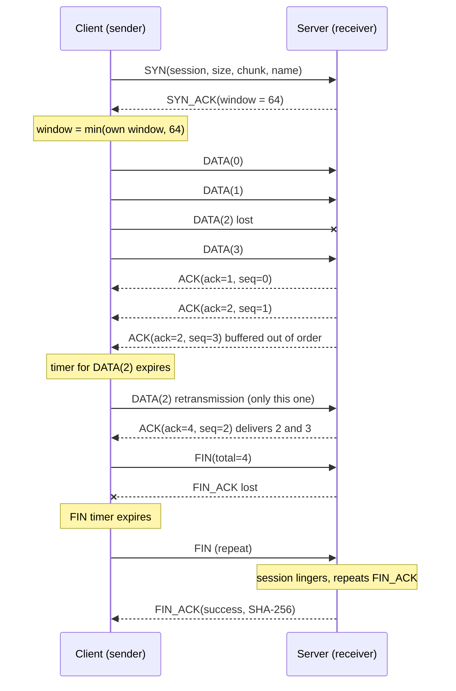
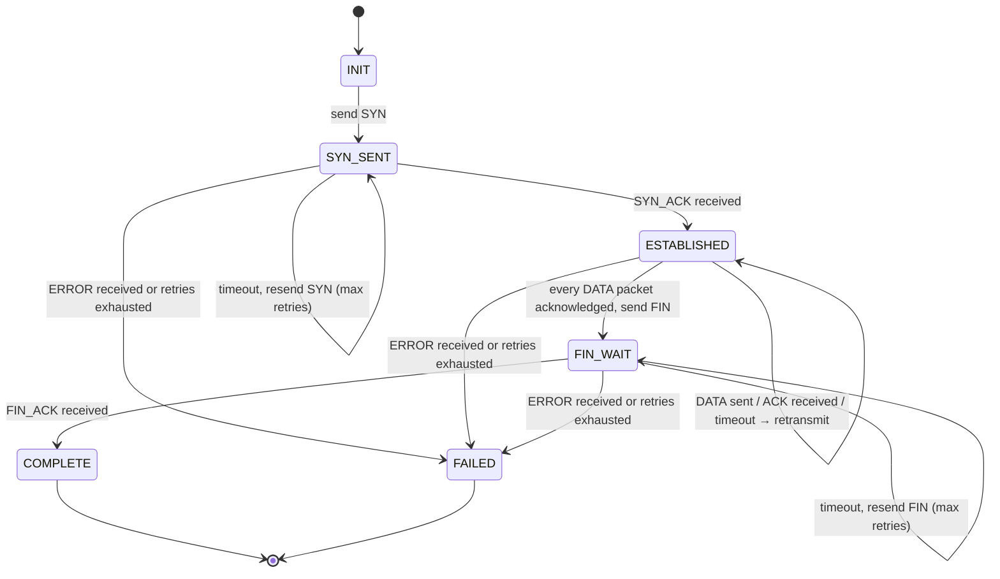

# Protocol specification

Version 1. Everything below is implemented in `reliableudp.protocol` (format) and `reliableudp.transport` (behaviour).

## 1. Datagram format

One protocol packet = one UDP datagram. All multi-byte fields are **big-endian (network byte order)** and **unsigned**.

| Offset | Size | Field | Meaning / validation |
|---:|---:|---|---|
| 0 | 1 | `version` | must be `1`, otherwise the packet is rejected |
| 1 | 1 | `type` | 1 SYN, 2 SYN_ACK, 3 DATA, 4 ACK, 5 FIN, 6 FIN_ACK, 7 ERROR; other values rejected |
| 2 | 2 | `window` | receiver's free buffer slots in packets (meaningful in SYN_ACK and ACK; 0 elsewhere) |
| 4 | 4 | `sessionId` | identifies the transfer; chosen by the client in 1 … 2³¹, confirmed by the server |
| 8 | 4 | `seq` | DATA: index of the chunk (0-based). ACK: echo of the DATA `seq` that triggered it. FIN/FIN_ACK: total number of DATA packets |
| 12 | 4 | `ack` | ACK: cumulative acknowledgement = next in-order sequence number the receiver needs. FIN_ACK: total packets |
| 16 | 2 | `payloadLength` | must equal `datagramLength − 22`, and ≤ 65 485 |
| 18 | 4 | `checksum` | CRC-32 (`java.util.zip.CRC32`) over bytes 0…17 followed by the payload |
| 22 | n | `payload` | type-specific (below) |

* Header size: **22 bytes**. Maximum datagram: **65 507 bytes** (IPv4 UDP limit) → maximum payload **65 485 bytes**. Recommended chunk ≤ 1 450 bytes (no IP fragmentation on Ethernet).
* A datagram is **rejected** (counted, logged, never acted on) if it is shorter than the header, has an unsupported version or unknown type, has a length field that disagrees with the datagram length, fails the CRC, or violates a per-type rule (DATA must have a payload; ACK, SYN_ACK and FIN must not).
* Nothing is serialised with Java serialisation; `PacketCodec` reads and writes every byte explicitly.

### Payloads

| Type | Payload |
|---|---|
| SYN | `u64 fileSize`, `u32 chunkSize`, `u16 nameLength`, `name` (UTF-8, 1–255 bytes). The name is the *base name only*; the server treats it as untrusted |
| SYN_ACK, ACK, FIN | none |
| DATA | `chunkSize` file bytes (the last packet carries the remainder) |
| FIN_ACK | `u8 status` (0 = success), `32 B SHA-256` of the reconstructed file, `u64 bytesWritten`, `u32 dataReceived`, `u32 duplicates`, `u32 outOfOrder`, `u32 invalid` (57 bytes) |
| ERROR | `u16 errorCode` + UTF-8 text (≤ 200 bytes). Codes: 1 BAD_REQUEST, 2 BAD_FILENAME, 3 FILE_TOO_LARGE, 4 SERVER_BUSY, 5 UNKNOWN_SESSION, 6 SESSION_EXISTS, 7 INCOMPLETE_TRANSFER, 8 INTERNAL_ERROR, 9 PROTOCOL_VIOLATION |

## 2. Message flow

## 3. State machines

Client side (`TransferSession.State`):

Server side, per session:

```mermaid
stateDiagram-v2
    [*] --> ESTABLISHED: valid SYN (SYN_ACK sent, .part file opened)
    ESTABLISHED --> ESTABLISHED: DATA → reassemble, ACK; repeated SYN → repeat SYN_ACK
    ESTABLISHED --> ESTABLISHED: early FIN → ERROR(INCOMPLETE_TRANSFER)
    ESTABLISHED --> COMPLETE: FIN and all data present → file committed, FIN_ACK sent
    COMPLETE --> COMPLETE: repeated FIN → repeat the same FIN_ACK
    COMPLETE --> [*]: linger time elapsed
    ESTABLISHED --> FAILED: idle timeout / write error / shutdown (partial files deleted)
    FAILED --> [*]
```

A session is looked up by **peer address + session id**; a packet carrying a valid id from another address gets `ERROR(UNKNOWN_SESSION)`.

## 4. Reliability algorithm: Selective Repeat

**Sender state** (`SlidingWindow`): `base` = lowest unacknowledged sequence number; `nextSeq` = next never-sent sequence number; for each packet in `[base, nextSeq)`: its payload, first-send time, deadline, retransmission count, acked flag.

**Window rule.** A new DATA packet `nextSeq` may be sent iff `nextSeq < totalPackets` and `nextSeq < base + min(windowSize, advertisedWindow)`. `advertisedWindow` is taken from SYN_ACK and refreshed by every ACK.

**Loop** (`ReliableSender.sendData`):
1. Send new packets while the window rule allows; start each packet's own timer (`retransmitTimeoutMs`).
2. Wait for a packet until the earliest deadline among unacknowledged packets.
3. On ACK: mark `seq` (the echoed packet) acknowledged; mark everything `< ack` acknowledged; slide `base` over the contiguous acknowledged prefix; update `advertisedWindow`; take an RTT sample if the echoed packet was never retransmitted.
4. For every packet whose deadline has passed: if it has already been retransmitted `maxRetransmissions` times, abort with *"packet N still unacknowledged after … retransmissions; peer unreachable"*; otherwise resend **that packet only** and re-arm its timer.
5. Done when `base == totalPackets`; then FIN.

**Receiver** (`ReliableReceiver`), with `rcvBase` = next sequence needed and `capacity` = receive window:

| Arriving DATA `seq` | Action | Reply |
|---|---|---|
| `≥ total`, or wrong payload length | ignore, count as invalid | none |
| `< rcvBase` (already delivered) | duplicate: count, do **not** rewrite | ACK |
| `≥ rcvBase + capacity` | outside window: drop | none |
| `== rcvBase` | write to disk, advance `rcvBase`, then flush buffered successors | ACK |
| `rcvBase < seq < rcvBase + capacity`, new | buffer (out of order) | ACK |
| same, already buffered | duplicate | ACK |

Every ACK: `ack = rcvBase`, `seq = echoed packet`, `window = capacity − buffered`. Because `rcvBase` itself is never buffered, `window ≥ 1`, so no zero-window probing is needed.

**Why the sender never overruns the receiver.** The sender's `base ≤ rcvBase` (it learns about progress only through ACKs), and it sends only below `base + advertised ≤ base + capacity ≤ rcvBase + capacity`, i.e. inside the receiver's acceptance range.

**ACK flavours.** *Cumulative* (`ack`) makes lost ACKs harmless: any later ACK repeats the information. *Selective* (`seq` echo) lets the sender stop timing packets the receiver already holds even while an earlier hole exists.

**Handshake.** SYN carries the transfer parameters; the server validates them (file name, size limit, chunk size, concurrent-session limit), reserves the output file, and answers SYN_ACK. A repeated or delayed SYN with identical parameters is answered with SYN_ACK again (idempotent, also mid-transfer); the same session id with different parameters gets `ERROR(SESSION_EXISTS)`. There is no third handshake message: the first DATA packet implicitly confirms it.

**Termination.** After all DATA is acknowledged the client sends `FIN(seq = total)`. If the server has every packet it closes the `.part` file, checks the size, moves the file into place, computes SHA-256 **from the file on disk**, stores a `FIN_ACK`, and sends it. The session is then kept for `lingerMillis`; a repeated FIN is answered with the *same stored FIN_ACK*. If the final ACK is lost, the client's FIN timer fires, it resends FIN, and the transfer still ends in success. If the client gives up before that, the server's file is still complete and verified — only the client's report is affected, which is the unavoidable "two generals" corner; the linger period makes it unlikely.

**Failure handling.** Unreachable peer → SYN is retried `maxRetransmissions` times, then *"no SYN_ACK … (server unreachable or not responding)"*. Server error → the client aborts with the error code and text. Server-side idle timeout → partial files are deleted. A file is never reported successful while data is missing: FIN with missing packets gets `ERROR(INCOMPLETE_TRANSFER)`.

## 5. Safe file handling on the server

1. The client's name must match `[\p{L}\p{N}._ ()-]{1,200}`, must not contain `..`, start/end with `.` or space, or be a Windows device name (`CON`, `NUL`, …). Anything else → `ERROR(BAD_FILENAME)`; separators (`/`, `\`), drive letters (`:`) and NUL are impossible by construction.
2. The target is created with `CREATE_NEW` semantics inside the downloads directory and re-checked to be a *direct child* of it. Existing files are never overwritten (`name (1).ext`, `name (2).ext`, …).
3. Data is written to `<target>.part` and moved into place only after the length check; failures delete both files.

## 6. Error-detection limits

CRC-32 detects all single-bit errors (tested exhaustively for one packet), all bursts ≤ 32 bits and nearly all random corruption (≈ 2⁻³² escape chance). It is not a MAC: a deliberate attacker can alter a packet and recompute it. The end-to-end SHA-256 of the whole file gives a second, independent check — also integrity only, not authentication.
